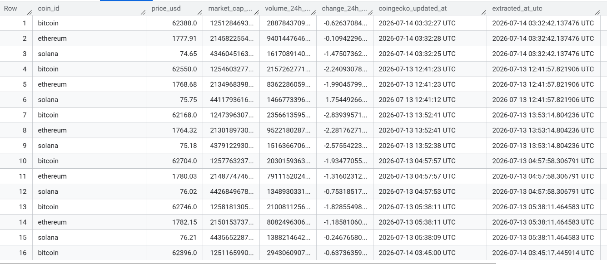

# Setup Guide — Daily Crypto Price Pipeline

> This is the detailed, step-by-step build guide — jargon explained, every
> command used, and every real error hit along the way. If you're looking
> for a quick overview of what this project does, see [README.md](README.md)
> instead. This file is for anyone who wants to reproduce or learn from the
> full build process.

[](LICENSE)

## 1. Architecture overview

```
Cloud Scheduler (daily, 6:00 AM UTC, cron: 0 6 * * *)
        |
        | triggers via HTTPS, authenticated with an OIDC token
        v
Cloud Function (daily-crypto-pipeline, region: asia-southeast1)
        |
        v
CoinGecko API  --->  extract.py  --->  transform.py  --->  load.py  --->  BigQuery table
     (source)          (E)              (T)                 (L)         (destination/warehouse)

  Authenticated as the crypto-pipeline-writer service account —
  no static keys anywhere in this flow.

              Local development/testing uses your own Google
              login (ADC) instead — see Step 3.5.

                     Analysis happens afterward via:
                     SQL queries run directly in BigQuery
                     (optional: Looker Studio dashboard on top)
```

> **Note on personal vs. Workspace/company GCP accounts:** this project was
> built and tested on a personal Gmail-based GCP account (no Google
> Workspace organization behind it). Google enforces a default security
> policy on personal accounts that blocks downloadable service account
> keys. This README's setup steps reflect the personal-account path —
> using your own login for local development (ADC) instead of a key file,
> and a service-account identity (no key) for the deployed Cloud Function.
> If you're on a company/Workspace GCP account, key-based auth may work
> for you out of the box, but keyless auth is the more secure choice either way.

---

## 2. Jargon glossary (read this before you start)

| Term | Meaning |
|---|---|
| **ETL** | Extract, Transform, Load — the three-stage pattern for moving data from a source into a place where it can be analyzed. |
| **ELT** | Same idea, different order — Load raw data first, Transform it afterward using the warehouse's own compute. Common with modern warehouses like BigQuery/Snowflake. Our project uses classic ETL for simplicity. |
| **Pipeline** | A series of automated steps that move/process data from one place to another. |
| **Source system** | Where your raw data originally lives — here, the CoinGecko API. |
| **Data warehouse** | A database optimized for analysis/reporting (lots of reading, aggregating) rather than for running an app (lots of small reads/writes). BigQuery is our warehouse. |
| **REST API** | A common way for two systems to talk over the internet: you send an HTTP request to a URL, you get data back (often as JSON). |
| **JSON** | JavaScript Object Notation — a text format for structured data, using key-value pairs, that looks a lot like Python dictionaries. |
| **Endpoint** | A specific URL on an API that does one particular job. |
| **Schema** | The defined structure of a dataset: which columns exist and what data type each holds (text, number, timestamp, etc). |
| **DataFrame** | pandas' core data structure — a table with rows and named columns, like one sheet in Excel. |
| **Idempotent** | An operation that gives the same end result no matter how many times you run it. (Our loads are NOT strictly idempotent since we append — running twice in a day would create duplicate rows, which is why query #4 in the SQL file checks for that.) |
| **Append vs. Truncate** | Append = add new rows to existing data. Truncate = delete everything and replace it. We append, since we want a growing history. |
| **Service account** | A non-human Google Cloud identity that code authenticates as, instead of using your personal Google login. |
| **Credentials / key file** | A secret JSON file containing a service account's "password." Must never be shared publicly or committed to Git. Blocked by default on personal GCP accounts (see ADC below). |
| **Application Default Credentials (ADC)** | A way for your code to authenticate using YOUR OWN Google login (via the `gcloud` CLI) instead of a service account key file. No downloadable secret to leak or lose — this is what personal GCP accounts use for local development in this project. |
| **Workload Identity Federation (WIF)** | A modern, keyless way for an external system (like GitHub Actions) to authenticate to GCP by "impersonating" a service account temporarily, without ever downloading a static key. More setup than a key file, but more secure and the current industry-recommended approach — worth mentioning by name in interviews. |
| **Impersonation** | When one identity (like GitHub Actions, via WIF) is granted temporary permission to act as another identity (a service account) without possessing its permanent credentials. |
| **Principle of least privilege** | Security best practice: only grant an identity (like a service account) the exact permissions it needs — nothing more. |
| **Environment variable** | A named value set outside your code (in your terminal, or in GitHub Secrets) that your code reads at runtime. Keeps secrets and settings out of your actual source code. |
| **GitHub Secrets** | An encrypted storage area in a GitHub repo's settings for sensitive values (like API keys), accessible to GitHub Actions workflows but hidden from anyone browsing the repo. |
| **GitHub Actions** | GitHub's built-in automation feature — runs your code on a schedule or trigger, using temporary free virtual machines. |
| **Workflow (YAML file)** | The configuration file that tells GitHub Actions what to run and when. YAML is a human-readable text format for configuration. |
| **Cron / cron syntax** | A standard way of expressing recurring schedules using five fields: minute, hour, day-of-month, month, day-of-week. E.g. `0 6 * * *` = every day at 6:00 AM. |
| **Orchestration** | Controlling the order, timing, and dependencies of pipeline steps (e.g., "don't run Load until Transform succeeds"). |
| **Window function** | A SQL feature that calculates values across a group of rows related to the current row (e.g., a moving average, a rank, or "the previous row's value") without collapsing rows the way GROUP BY does. |
| **PARTITION BY** | Inside a window function, this defines the "group" the calculation applies within — e.g., partition by coin_id so each coin's rolling average is calculated separately. |
| **LAG()** | A window function that looks backward to a previous row's value within the same partition — useful for period-over-period comparisons. |
| **Moving average** | An average recalculated over a sliding window of recent data points, used to smooth out noise and show trend. |
| **Defensive coding** | Writing code that anticipates and gracefully handles missing/bad input, instead of assuming everything will always work perfectly. |
| **Data quality check** | An automated test that catches bad data (nulls, duplicates, out-of-range values) before or after it lands in your warehouse. |
| **Free tier / Always Free** | GCP services you can use up to a certain monthly limit at zero cost, indefinitely (as opposed to the one-time $300 trial credit, which expires after 90 days). |
| **Cloud Function** | A small piece of code Google runs for you on demand — you don't manage a server, you just deploy your function and Google handles hosting, scaling, and teardown. Ours is triggered by an HTTP request. |
| **Entry point** | The one specific function Google calls when your Cloud Function is triggered — everything else in your code is just supporting logic that entry point calls into. Ours is `run_pipeline` in `cloud_function/main.py`. |
| **HTTP trigger** | A way of invoking a Cloud Function by sending it a web request (the same mechanism your browser uses to load pages) to a unique URL Google assigns it. |
| **Cloud Run** | The underlying platform 2nd-generation Cloud Functions actually run on top of. This matters practically because some permissions (like the invoker role) sometimes need to be granted on the Cloud Run service directly, not just through `gcloud functions` commands. |
| **Cloud Scheduler** | GCP's built-in cron-job service — lets you trigger something (like our Cloud Function) on a recurring schedule, entirely inside GCP. |
| **OIDC token** | A signed, short-lived identity credential that one Google service (like Cloud Scheduler) presents to another (like our Cloud Function) to prove "this request is really coming from me" — without ever using a static password or key. |
| **`--no-allow-unauthenticated`** | A deploy flag that makes a Cloud Function reject anonymous requests — only identities explicitly granted the invoker role (like our service account) can call it. |
| **Invoker role** | The specific permission (`roles/run.invoker`) that lets an identity actually call/trigger a Cloud Function or Cloud Run service. Separate from permissions to read/write data — this one is purely "are you allowed to start this running at all." |
| **`bigquery.jobUser`** | A separate BigQuery permission from `BigQuery Data Editor` — Data Editor lets you read/write table data, but actually running a load/query *job* (the mechanism behind `load_table_from_dataframe`) needs this role too. |

---

## 3. Step-by-step setup

### Step 3.1 — Create your free GCP project
1. Go to console.cloud.google.com and sign in with a Google account.
2. Create a new project (top-left project dropdown → "New Project"). Give it
   a name like `crypto-pipeline-portfolio`.
3. You'll be asked to attach a billing account (requires a card for identity
   verification), but you will not be charged as long as you stay within
   BigQuery's Always Free monthly limits (1 TB of queries, 10 GB of storage).

### Step 3.2 — Enable the BigQuery API
1. In the search bar at the top of the GCP console, search "BigQuery API."
2. Click it, then click "Enable" if it isn't already.

### Step 3.3 — Create the BigQuery dataset
1. Go to the BigQuery console (search "BigQuery" in the top search bar).
2. In the Explorer panel, click your project name → "Create dataset."
3. Dataset ID: `crypto_pipeline`. Choose a region close to you (or the US
   multi-region, which is what most free-tier guides assume).
4. You do NOT need to create the table manually — our `load.py` script
   auto-creates it on the very first run using `autodetect=True`.

### Step 3.4 — Create a service account (still needed, for table permissions)
Even without a downloadable key, you still create a service account — it's
the identity your queries and (later) any automation will act as.
1. In the GCP console search bar, search "Service Accounts."
2. Click "Create Service Account." Name it something like
   `crypto-pipeline-writer`.
3. Grant it the role **BigQuery Data Editor** (lets it write to tables, but
   not, say, delete the whole project — principle of least privilege).
4. Click **Create and continue** through the remaining steps — you don't
   need to grant any other principals access.

> **If you're on a personal Gmail-based GCP account**, you may see a
> **"Service account key creation is disabled"** message if you try to
> download a JSON key here — this is a default Google security policy
> (`iam.disableServiceAccountKeyCreation`), and personal accounts usually
> can't be granted the org-level permission needed to override it. That's
> expected and not something you did wrong. Skip key creation entirely —
> Step 3.5 below shows the workaround.

### Step 3.5 — Authenticate locally using your own Google login (ADC)
This replaces the "download a JSON key" step for personal GCP accounts.

1. Install the Google Cloud CLI: go to `cloud.google.com/sdk/docs/install`,
   download the installer for your OS, run it.
2. Close and reopen your terminal so it picks up the new install.
3. Confirm it installed: `gcloud --version`
4. Log in with the same Google account as your GCP project:
   ```bash
   gcloud auth application-default login
   ```
   This opens a browser window — log in, click Allow. From now on, any
   Google client library on your machine (including our `load.py`) will
   automatically use this login when it needs credentials — no key file,
   no `GOOGLE_APPLICATION_CREDENTIALS` variable needed at all.
5. Set your active project:
   ```bash
   gcloud config set project YOUR_PROJECT_ID
   ```
   (Find your exact project ID in the GCP console header, e.g.
   `project-8bafca5b-90b6-4077-819` — it's usually not the same as the
   display name you typed when creating the project.)

### Step 3.6 — Test locally
```bash
cd crypto-pipeline
pip install -r requirements.txt

# Windows Command Prompt:
set GCP_PROJECT_ID=your-project-id

# Windows PowerShell:
$env:GCP_PROJECT_ID="your-project-id"

# Mac/Linux:
export GCP_PROJECT_ID="your-project-id"

cd scripts
python main.py
```
Notice there's no `GOOGLE_APPLICATION_CREDENTIALS` variable here — ADC from
Step 3.5 handles authentication automatically. If this runs without errors,
check the BigQuery console — you should see a new `daily_prices` table
under your `crypto_pipeline` dataset with rows in it.

### Step 3.7 — Automate the daily run (this is what's actually deployed)

This project runs automatically using **Cloud Functions + Cloud Scheduler**
— entirely inside GCP, no static keys, no external service needed.

**Enable the required APIs:**
```bash
gcloud services enable cloudfunctions.googleapis.com cloudscheduler.googleapis.com cloudbuild.googleapis.com run.googleapis.com
```

**Deploy the function**, pointing it at the `cloud_function/` folder and
telling it to run as your service account (this last part matters — without
it, the function runs as a default account with no BigQuery permissions):
```bash
gcloud functions deploy daily-crypto-pipeline \
  --gen2 \
  --runtime=python312 \
  --region=asia-southeast1 \
  --source=cloud_function \
  --entry-point=run_pipeline \
  --trigger-http \
  --no-allow-unauthenticated \
  --run-service-account=crypto-pipeline-writer@YOUR_PROJECT_ID.iam.gserviceaccount.com \
  --set-env-vars=GCP_PROJECT_ID=YOUR_PROJECT_ID,BQ_DATASET_ID=crypto_pipeline,BQ_TABLE_ID=daily_prices
```
This prints a URL when it finishes — copy it, you'll need it below.

**Grant your service account permission to actually trigger the function**
(separate from permission to write data — this is "are you allowed to
start this running at all"):
```bash
gcloud functions add-invoker-policy-binding daily-crypto-pipeline \
  --region=asia-southeast1 \
  --member=serviceAccount:crypto-pipeline-writer@YOUR_PROJECT_ID.iam.gserviceaccount.com
```
If Cloud Scheduler still gets an authentication error later, the invoker
role sometimes needs to be granted directly on the underlying Cloud Run
service too (2nd-gen Cloud Functions run on Cloud Run under the hood):
```bash
gcloud run services add-iam-policy-binding daily-crypto-pipeline \
  --region=asia-southeast1 \
  --member=serviceAccount:crypto-pipeline-writer@YOUR_PROJECT_ID.iam.gserviceaccount.com \
  --role=roles/run.invoker
```

**Grant the BigQuery job-running permission** (separate from Data Editor —
Data Editor lets you read/write table data, but running the actual load
job needs this too):
```bash
gcloud projects add-iam-policy-binding YOUR_PROJECT_ID \
  --member=serviceAccount:crypto-pipeline-writer@YOUR_PROJECT_ID.iam.gserviceaccount.com \
  --role=roles/bigquery.jobUser
```

**Create the Cloud Scheduler job** that calls your function every day:
```bash
gcloud scheduler jobs create http daily-crypto-trigger \
  --schedule="0 6 * * *" \
  --uri="YOUR_CLOUD_FUNCTION_URL" \
  --http-method=POST \
  --oidc-service-account-email=crypto-pipeline-writer@YOUR_PROJECT_ID.iam.gserviceaccount.com \
  --oidc-token-audience="YOUR_CLOUD_FUNCTION_URL" \
  --location=asia-southeast1
```

**Test it manually before trusting the schedule:**
```bash
gcloud scheduler jobs run daily-crypto-trigger --location=asia-southeast1
```
Then check BigQuery for a new row, or check the function's logs:
```bash
gcloud functions logs read daily-crypto-pipeline --region=asia-southeast1 --gen2 --limit=10
```

> **A more direct way to see the actual error if something fails:** this
> project's `cloud_function/main.py` catches exceptions and returns the
> error message directly in the HTTP response body — which is often more
> reliable to read than digging through Cloud Logging. Call the function
> directly with a valid identity token:
> ```bash
> curl -X POST -H "Authorization: Bearer $(gcloud auth print-identity-token)" -d "" YOUR_CLOUD_FUNCTION_URL
> ```
> The `-d ""` forces curl to send a `Content-Length: 0` header, avoiding a
> confusing unrelated "411 Length Required" error from Google's front end.

**Alternative/next-step — GitHub Actions with Workload Identity Federation**
A `.github/workflows/daily_pipeline.yml` file is also included in this repo
as a documented alternative orchestration approach — it is **not** the
active automation for this project. Because personal GCP accounts can't
create service account key files, that workflow (which assumes a
`GCP_SERVICE_ACCOUNT_KEY` secret) won't run as-is. Making it work would
mean setting up Workload Identity Federation, which lets GitHub Actions
temporarily "impersonate" a service account instead of holding a permanent
key. This is a good documented follow-up enhancement — worth doing to be
able to compare both orchestration approaches directly, and a good specific
term to mention in interviews ("I used Cloud Scheduler for the production
path, and could also set this up via GitHub Actions with Workload Identity
Federation").

### Step 3.8 — Run your analysis
Open the BigQuery console's Query Editor and run the queries in
`sql/analysis_queries.sql` (remember to replace `your-project-id` with your
actual project ID first).

### Step 3.9 (optional) — Build a free dashboard
Go to lookerstudio.google.com → "Create" → "Data Source" → choose
"BigQuery" → select your table. Looker Studio is Google's free BI
(Business Intelligence) tool — it connects directly to BigQuery with no
extra setup, and you can build line charts of price trends in a few
clicks. This gives you a shareable dashboard link for your portfolio too.

---

## 4. Sample output

> This section is proof-of-work for anyone skimming your repo — it shows
> the pipeline actually runs and produces real data, without them needing
> to set up GCP themselves just to check.



**Real query result — latest price per coin (July 14, 2026):**

| coin_id | price_usd | change_24h_pct | extracted_at_utc |
|---|---|---|---|
| bitcoin | 62,388.00 | -0.63 | 2026-07-14 03:32:42 UTC |
| ethereum | 1,777.91 | -0.11 | 2026-07-14 03:32:42 UTC |
| solana | 74.65 | -1.47 | 2026-07-14 03:32:42 UTC |

The table above accumulated 16 rows across several separate pipeline runs
(both manual testing runs and scheduled ones) over July 13–14, 2026,
confirming the append behavior works as designed — every run adds new
history rather than overwriting the previous day's data.

---

## 5. Project structure

```
crypto-pipeline/
├── scripts/
│   ├── extract.py       # Pulls raw JSON from CoinGecko
│   ├── transform.py     # Cleans/reshapes into a pandas DataFrame
│   ├── load.py           # Writes DataFrame into BigQuery
│   └── main.py            # Runs all three stages in order (local/manual use)
├── cloud_function/
│   ├── main.py            # Entry point (run_pipeline) — the deployed automation
│   ├── extract.py         # Same logic as scripts/extract.py, packaged for deployment
│   ├── transform.py       # Same logic as scripts/transform.py
│   ├── load.py             # Same logic as scripts/load.py
│   └── requirements.txt  # Dependencies for the Cloud Function specifically
├── sql/
│   └── analysis_queries.sql   # SQL for trends, moving averages, QA checks
├── .github/workflows/
│   └── daily_pipeline.yml     # Alternative orchestration approach (see Step 3.7) —
│                                 not the active automation; needs WIF to work as-is
├── assets/                    # Screenshots for the README
├── requirements.txt        # Python dependencies (for local/manual runs)
├── .env.example             # Reference for env var names (ADC path doesn't need a credentials path)
├── .gitignore                # Prevents committing secrets/credentials
├── LICENSE                   # MIT License
└── README.md               # This file
```

---

## 6. Common issues and what they mean

- **"Service account key creation is disabled"** → expected on personal GCP
  accounts (see Step 3.4's note). Use ADC (Step 3.5) instead of a key file.
- **`$env:` command gives "filename, directory name, or volume label syntax
  is incorrect"** → you're in Command Prompt, not PowerShell. Use
  `set VARIABLE=value` instead (no `$env:`, no quotes).
- **Windows opens a "Select an app to open this .py file" popup** → you
  typed `main.py` alone instead of `python main.py`. Always include
  `python` before the filename.
- **`pip install` fails trying to build pandas from source (mentions
  `meson`, `vswhere.exe`, or a C++ compiler)** → your Python version is too
  new and doesn't have pre-built pandas wheels yet. Install Python 3.12
  specifically and create a virtual environment with it (`py -3.12 -m venv
  venv`) rather than using the newest Python version.
- **`gcloud` command says a project "not found or permission denied"** →
  you're using the project's display name instead of its real project ID.
  Run `gcloud config set project YOUR_ACTUAL_PROJECT_ID` (find the ID in
  the GCP console header, not the name you typed when creating it).
- **"The default build service account is missing the
  cloudbuild.builds.builder role"** during `gcloud functions deploy` → a
  one-time permission Google's own build system needs on newer projects.
  Fix with the exact `gcloud projects add-iam-policy-binding ... --role=
  roles/cloudbuild.builds.builder` command the error message itself prints,
  then retry the deploy.
- **Cloud Scheduler run returns "The request was not authenticated. ...
  Empty Authorization header value"** → the invoker permission granted via
  `gcloud functions add-invoker-policy-binding` didn't fully take effect.
  Grant it again directly on the underlying Cloud Run service (2nd-gen
  Cloud Functions run on Cloud Run under the hood):
  `gcloud run services add-iam-policy-binding ... --role=roles/run.invoker`
- **`gcloud functions logs read` shows blank/`null` log entries for
  errors** → 2nd-gen function errors are often better read straight from
  the HTTP response body than from logs. Call the function directly:
  `curl -X POST -H "Authorization: Bearer $(gcloud auth print-identity-token)" -d "" YOUR_FUNCTION_URL`
  (the `-d ""` avoids an unrelated "411 Length Required" error from Google's
  front end when POSTing an empty body).
- **BigQuery `403 Access Denied` when called from inside the Cloud
  Function, even though it works locally** → the function is running as
  GCP's default compute service account, not your intended one. Redeploy
  with `--run-service-account=crypto-pipeline-writer@YOUR_PROJECT_ID.iam.gserviceaccount.com`
  explicitly set.
- **`403 ... User does not have bigquery.jobs.create permission`** → even
  with BigQuery Data Editor granted, running a load job needs the separate
  `roles/bigquery.jobUser` role too. Grant it with
  `gcloud projects add-iam-policy-binding ... --role=roles/bigquery.jobUser`.
- **"Service Unavailable" on a Cloud Function call** → often just a cold
  start timing out on first load of heavier libraries (pandas, pyarrow,
  the BigQuery client). Simply retry once or twice before assuming it's a
  real problem; if it persists, redeploy with `--memory=512Mi --timeout=120s`.
- **`quotaExceeded` error** → you've hit a free-tier limit (unlikely at this
  small scale, but worth knowing the term).
- **Duplicate rows for the same day** → the pipeline ran more than once
  that day (common while testing manually). Use SQL query #4 in
  `analysis_queries.sql` to detect this.

---

## 7. Natural next steps to extend this project further

- Set up Workload Identity Federation so the included GitHub Actions
  workflow can also run successfully, as a second, comparable orchestration
  path alongside Cloud Scheduler (see Step 3.7's alternative note).
- Add more coins or switch to a stocks/forex API for variety.
- Add a monitoring/alerting job that runs the QA query on a schedule and
  emails or notifies you if duplicates or gaps are found (this mirrors real
  "data pipeline monitoring").
- Add unit tests (pytest) for the transform logic — this is a common
  interview talking point ("how did you test your pipeline?").
- Build the optional Looker Studio dashboard (Step 3.9) for a shareable,
  visual view of the accumulating price trends.
